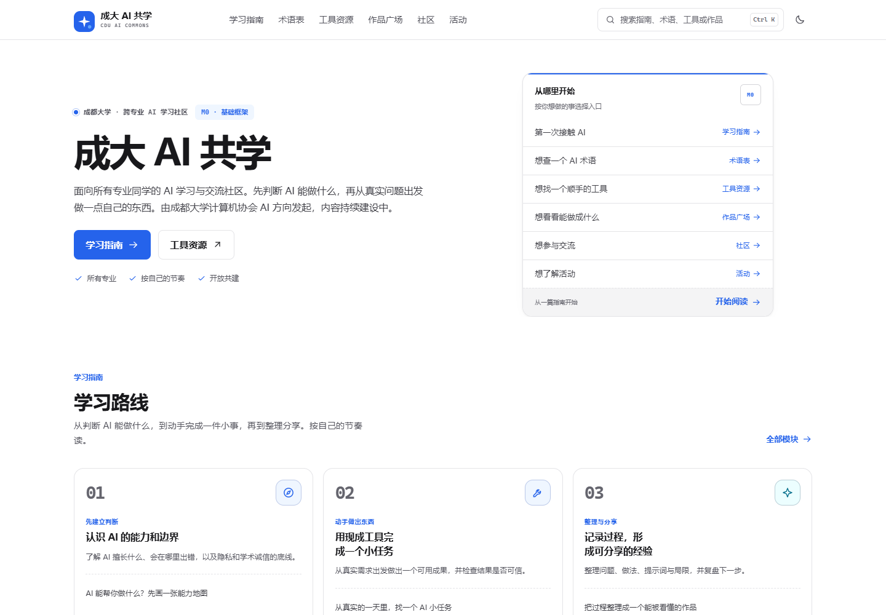
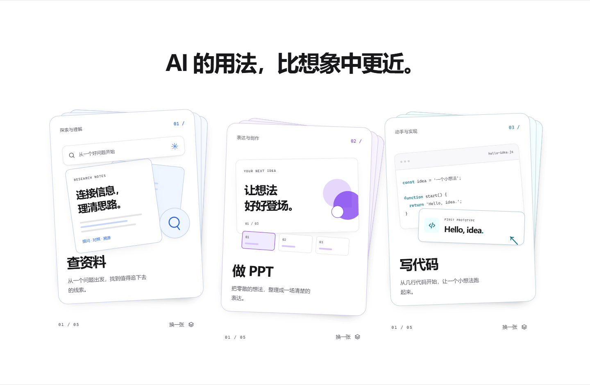
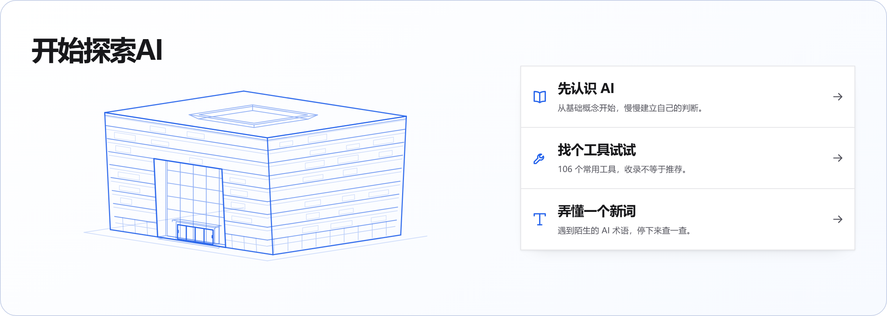
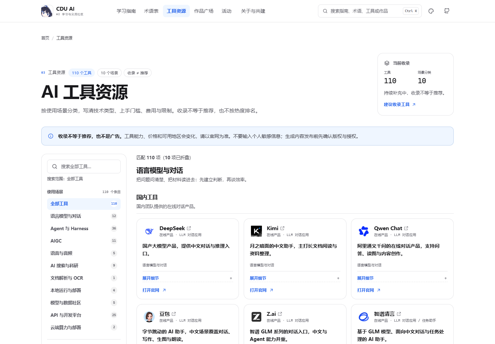
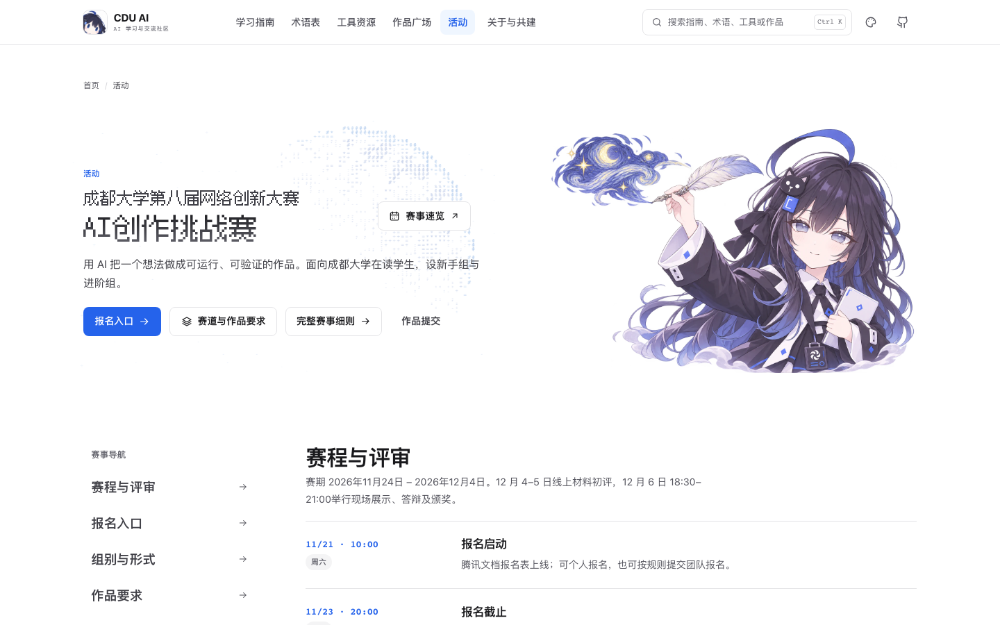

# CDU AI

面向成都大学全校同学的开放 AI 学习站与共建项目。先从一个具体问题出发，找到合适的工具，再把可复现的做法整理成指南。

由成都大学计算机协会 AI 方向发起，**非学校官方平台**。

**访问网站：[wiki.cduai.top](https://wiki.cduai.top/)**

[参与共建](CONTRIBUTING.md) · [文档导航](docs/README.md) · [贡献与致谢](CONTRIBUTORS.md) · [反馈问题](https://github.com/A7m0spHere/CDU-AI/issues)

> **M0 · 开发中**：首页、学习指南、工具目录和术语表已可浏览，指南章节继续补充；作品广场已上线本次活动模板，参赛作品提交后开放。账号、论坛、评论和站内投稿表单尚未开放。AI 创作挑战赛通过腾讯文档报名。



## 当前可以看什么

以下说明仓库已实现的功能与内容边界。条目和数量以当前数据及页面为准，内容审校范围以各批次记录为准；收录不等于推荐。

- **首页**：三组共 15 个 AI 应用场景，支持换卡浏览，手机端提供显性搜索入口；「开始探索AI」以成都大学主图书馆线稿（支持拖动旋转与入口联动）和流动菜单连接指南、工具和术语。场景展示不代表站内提供相应执行能力。
- **工具资源**：按主要用途组织工具、项目与社区资源，OCR 独立成栏，Agent 含「Personal Agent · 个人助理」分区，AIGC 包含设计、演示、文档和创作工作流；支持按栏目浏览和搜索，能力标签可作搜索关键词。桌面端为卡片目录，手机端为 App 图标网格与底部详情抽屉，更多开源 Agent 默认折叠，暂不收录独立模型。
- **AI 术语表**：按 AI 主分支与延伸分支建设现代词典目录与极简维基详情页，支持桌面与手机端分支切换及横滑分类浏览，包含定义、来源、示例与词条互链。不同批次的审核范围与方式分别记录，见[文档导航](docs/README.md)，不将 AI 初审等同于人工二审。
- **学习指南**：「欢迎来到 CDU AI」介绍站点。已有《这份指南适合谁》《AI 使用常见问题》（标为「可选读」）、《从 Chat AI 到 Agent》、《第一次使用 Agent》（含交互步骤与全部实操对比截图）、《提示词撰写思路》《权限与结果检查》和《资料检索：从 AI 回答找到原始依据》。支持代码块一键复制、窄屏表格横滑与正文配图灯箱放大，尚无正文的章节标为「待补充」。
- **作品广场**：已上线本届活动的 8 个新手模板，可在线体验与下载模板包；参赛作品提交截止并审核后以作者外链展示。
- **社区与活动**：社区暂不开放。活动页发布第八届 AI 创作挑战赛的赛程、腾讯文档报名入口、分组与作品提交说明，并提供赛事速览弹窗与赛道抽屉；评分表在完整赛事细则中查看。
- **站内搜索**：支持页面、工具与现有内容检索，欢迎页的小节也可搜索。快捷键为 Ctrl / Cmd + K，支持键盘操作和加载失败重试。
- **主题与阅读**：支持浅色、深色、预设和自定义主题，可调整配色、背景与字体；主题面板底部提供默认关闭、跟随主题强调色的「鼠标光效」与「光效拖尾」开关。宽屏桌面可通过右侧「本页目录」跳转到指南、术语和作品详情的小节，手机端提供底部拇指快捷栏与「本页小节」抽屉。

<details>
<summary>查看首页应用场景与探索入口</summary>





</details>

<details>
<summary>查看工具目录界面</summary>



</details>

<details>
<summary>查看活动页首屏</summary>



</details>

首页、探索区、工具目录与活动页截图分别采集于 2026-10-27、2026-11-12、2026-11-20 与 2026-11-21，均来自本地生产构建。内容数量以当前页面为准，项目状态见上方 M0 说明。

## 参与共建

不需要先会编程。可以从一处错误、一条来源或一次真实使用经验开始：

- **编辑文档**：使用 [文档编辑表单](https://github.com/A7m0spHere/CDU-AI/issues/new?template=doc-correction.yml) 提交纠错、更新、改写或补充建议。
- **分享实践**：使用 [经验投稿表单](https://github.com/A7m0spHere/CDU-AI/issues/new?template=experience-submission.yml)，写清实际需求、做法、结果与遇到的问题。
- **推荐或更新工具**：使用 [工具建议表单](https://github.com/A7m0spHere/CDU-AI/issues/new?template=tool-suggestion.yml)，由维护者核对后入库。
- **改代码、样式或测试**：阅读 [贡献指南](CONTRIBUTING.md)，按 PR 模板说明修改与验证结果。

AI 可以辅助整理和起草，但不能虚构经历、数据或同学评价。内容类贡献需要声明 AI 用途，内容审核与真实使用经验分别记录；开发者可使用 AI 初审和辅助审核，最终结论由审核负责人确认。署名规则见 [贡献指南第 8 节](CONTRIBUTING.md#8-署名与致谢)。

## 本地运行

需要 **Node.js ≥ 22**。仓库使用 Astro 5、TypeScript 和原生 CSS，构建产物为静态文件。

```bash
npm ci
npm run dev
```

打开 [http://localhost:4321](http://localhost:4321) 查看本地站点。

```bash
npm run verify        # 类型检查、内容与文档校验、构建、测试与站内链接检查
npm run build         # 生成 dist/
npm run preview       # 预览构建产物
npm run test:browser  # Playwright 浏览器回归（需先 build 并安装 Chromium）
```

不需要配置数据库或模型 API Key。站点本身不调用大模型服务。

## 内容与开发文档

- [文档导航](docs/README.md)：按内容维护、工具目录、设计与开发任务查找说明。
- [贡献指南](CONTRIBUTING.md)：GitHub 网页贡献、本地开发、审稿与署名流程。
- [内容维护规范](docs/CONTENT-GUIDE.md) / [内容可信度与审校](docs/CONTENT-REVIEW.md)：字段、写作模板、来源与审核状态。
- [架构说明](docs/ARCHITECTURE.md)：内容模型、目录组织、验证流程与阶段边界。
- 模块开发说明：[主题系统](docs/modules/theme.md)、[工具目录](docs/modules/tool-catalog.md)、[站内搜索](docs/modules/search.md)，包含职责、数据流、修改路径和测试入口。

内容放在 `src/content/`；工具等结构化数据放在 `src/data/`。新增指南时，还需在 `src/data/guide-nav.ts` 登记目录位置。详细文件地图和操作步骤见贡献指南。

## 许可与素材

[代码许可（MIT）](LICENSE) · [素材来源与使用说明](docs/README.md#品牌素材与截图) · [贡献与致谢](CONTRIBUTORS.md)
