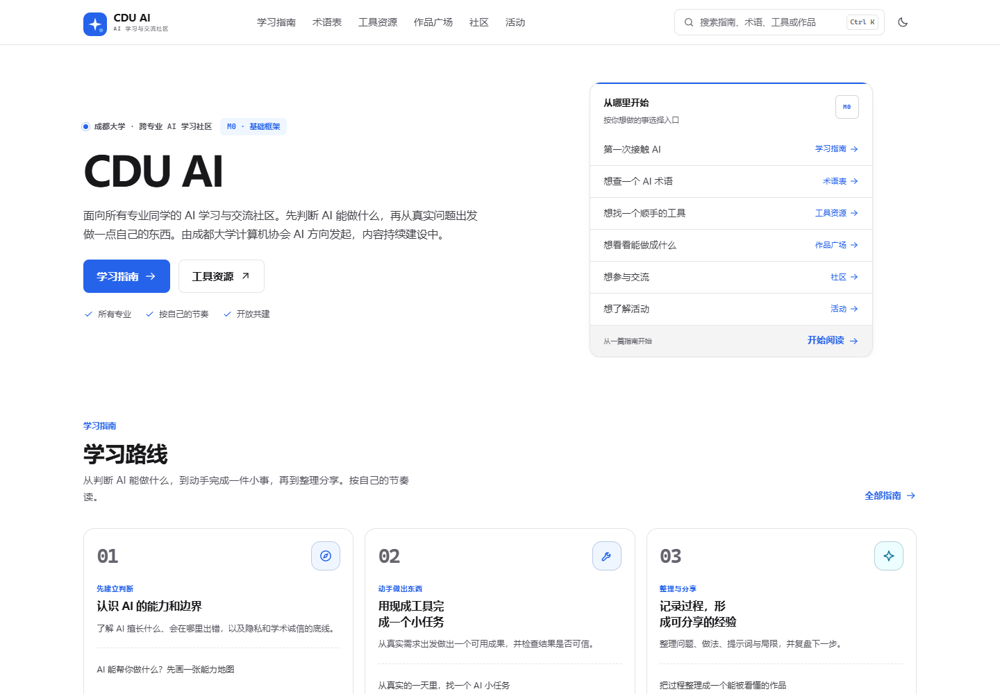
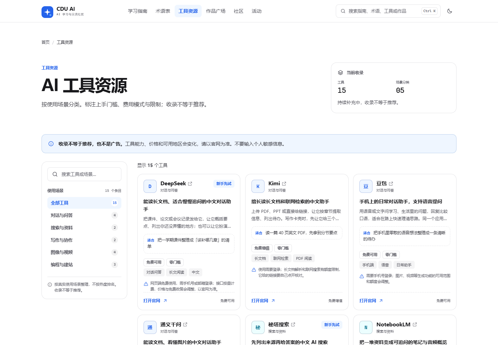
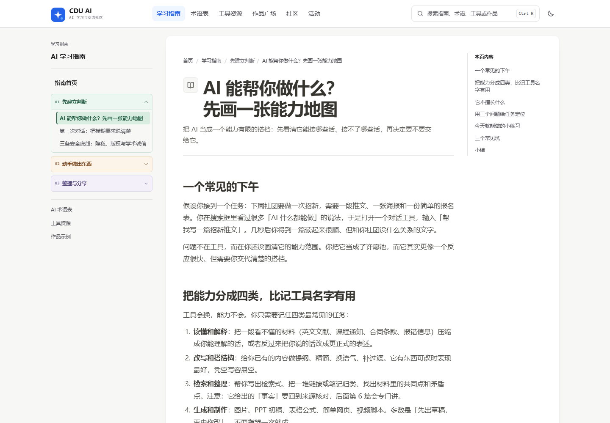
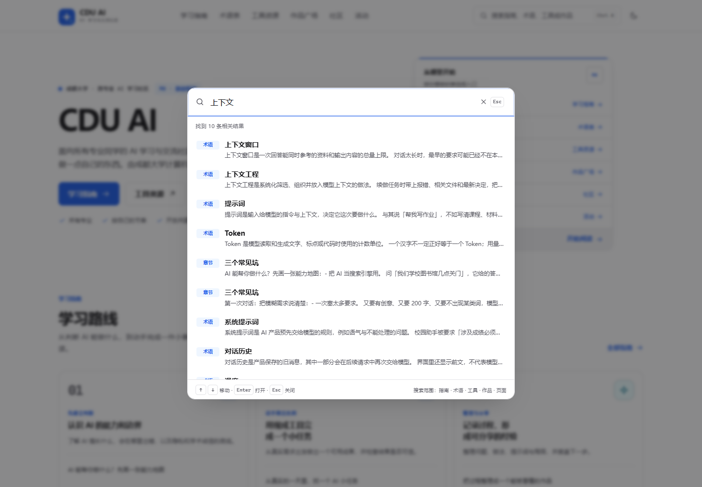
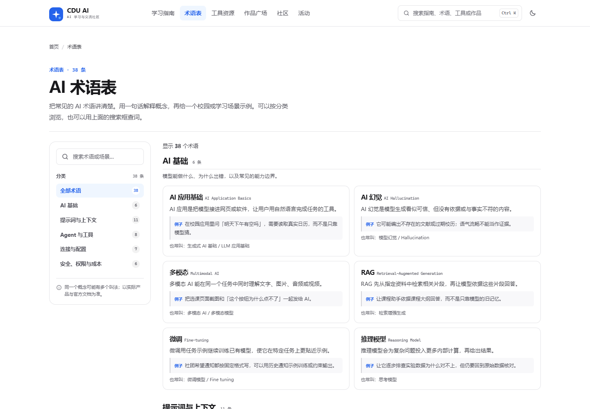
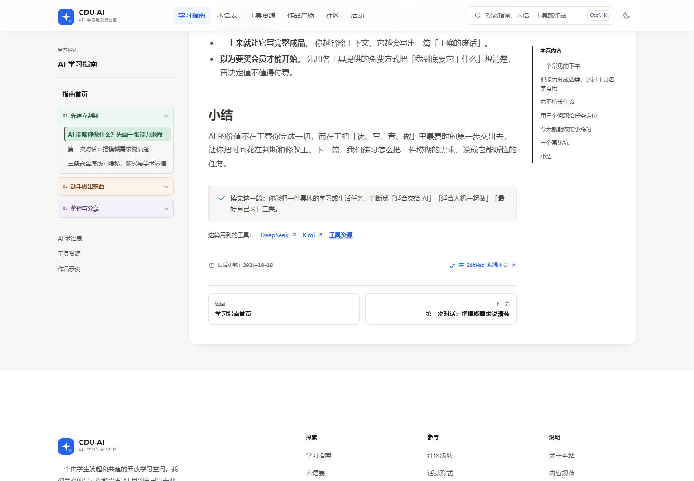

# CDU AI

> 面向成都大学全校学生的开源 AI 学习与交流社区。  
> **项目阶段：M0 · 基础框架**，由成都大学计算机协会 AI 方向发起，非学校官方平台。  
> [GitHub 仓库](https://github.com/A7m0spHere/CDU-AI) · [MIT License](LICENSE)

## 品牌与占位素材

站点名称为 **CDU AI**。当前的 LogoMark、favicon 和作品封面仍使用占位图形，正式标识与主视觉可以后续替换；组件尺寸和替换位置已经保留。

- Logo：[src/components/LogoMark.astro](src/components/LogoMark.astro)
- Favicon：[public/favicon.svg](public/favicon.svg)
- 作品封面：[src/components/WorkArt.astro](src/components/WorkArt.astro)

## 这是什么

很多 AI 教程默认你已经会写代码、懂术语、有 GPU。这个站想反过来：**从每个专业都能理解的真实问题出发，先学会安全地用，再慢慢做出自己的东西。**

M0 先交付可持续迭代的框架，而不是堆功能：

- 全局搜索：顶栏搜索框 / Ctrl·Cmd + K，支持页面、指南章节、术语、工具和作品；结果可直达正文锚点
- 首页：定位、入口、学习路径、工具与作品预览、社区与活动预告
- 学习指南：三阶段、8 个模块；浅灰画布 + 白色文档卡，正文采用 Notion 风格排版；每页显示最后更新时间、参考来源和 GitHub 编辑入口
- 术语表：38 个零基础 AI 术语，按分类筛选，含校园场景示例；来源统一标注在页面末尾
- 工具资源：按真实使用场景分类、可搜索筛选的工具目录
- 作品广场：明确标注的「策划示例」，展示未来投稿作品会如何被组织
- 社区：版块设计、讨论起点、社区公约与参与路径（M0 不开放真实发帖）
- 活动：活动形式蓝图与项目路线（不虚构日期、场地、嘉宾或参与人数）
- 关于 / 共建：项目边界、透明说明与内容协作规范

## 界面预览

| 首页 | 工具资源 |
| --- | --- |
|  |  |

| 学习指南 | 全局搜索（Ctrl/Cmd + K） |
| --- | --- |
|  |  |

| AI 术语表 | 内容元信息 |
| --- | --- |
|  |  |


## 技术栈

| 选择 | 原因 |
| --- | --- |
| **Astro 5**（静态输出） | 内容型站点首选；默认输出静态 HTML；Markdown 内容与页面代码天然分离 |
| **TypeScript** | 数据文件有类型约束，协会多人协作时更不容易把字段写坏 |
| **原生 CSS**（设计令牌 + 分层样式） | 不引入重型 UI 框架；白底、蓝色交互色与目录式筛选可精细控制 |
| **Astro Content Collections + Markdown** | 同学新增一篇指南 = 新增一个 .md 文件，不需要碰页面代码 |
| **少量原生脚本**（约 7KB） | 只负责全局搜索、筛选、主题、复制与移动菜单；无 JS 时核心内容仍可阅读，增强入口自动隐藏 |

无后端、无登录、无数据库、无第三方统计脚本。未来接入投稿/评论时，可从静态内容层平滑过渡到 API。

## 本地运行

环境：Node.js ≥ 22。

```bash
npm install
npm run dev        # http://localhost:4321
npm run verify     # 类型检查 + 生产构建 + 内容测试 + 内部链接检查
```

其他命令：

```bash
npm run check       # Astro / TypeScript 类型检查
npm run build       # 生成静态站点到 dist/
npm run preview     # 本地预览生产构建
npm run test        # 构建后的页面结构、M0 标注与链接安全测试
npm run check:links # 检查 dist/ 中指向站内的链接是否存在
```

## 目录结构

```text
src/
├── components/          # 可复用 UI（导航、卡片、封面、图标等）
├── content/
│   ├── guide/           # 学习指南：一篇 Markdown = 一个模块
│   └── works/           # 作品广场：示例提案 / 未来真实投稿
├── data/                # 工具、术语、社区、活动、首页入口等结构化内容
│   ├── types.ts         # 内容类型约束
│   ├── site.ts          # 站点名、导航、页脚与透明说明
│   ├── home.ts          # 首页入口与学习地图
│   ├── glossary.ts      # AI 术语表
│   ├── tools.ts         # 工具目录
│   ├── community.ts     # 社区版块、话题、公约
│   └── events.ts        # 活动形式与项目路线
├── layouts/             # 全局页面骨架
├── pages/               # 路由页面 + 构建时搜索索引 search-index.json
├── scripts/             # 全局交互与筛选等渐进增强脚本
├── styles/              # 设计令牌、基础/组件/页面样式与视觉收口
└── content.config.ts    # 内容集合 frontmatter 校验
tests/site.test.mjs      # 构建产物的结构与内容边界测试
.github/workflows/ci.yml # CI：类型检查、构建、测试与链接检查
docs/
├── ARCHITECTURE.md      # M0 架构决策与信息架构
├── CONTENT-GUIDE.md     # 内容字段规范、语气与禁写事项
└── DESIGN-SYSTEM.md     # 视觉语言与组件约定
scripts/check-links.mjs  # 构建产物内部链接检查
```

## 内容怎么维护

完整文件地图、写作流程和提交检查见 [`CONTRIBUTING.md`](CONTRIBUTING.md)。

1. 阅读 [`docs/CONTENT-GUIDE.md`](docs/CONTENT-GUIDE.md)，确认字段、语气与事实边界。
2. 学习指南：在 `src/content/guide/` 新建 `.md`，按指定 frontmatter 填写；页面自动生成并排序。
3. 作品示例：在 `src/content/works/` 新建 `.md`。M0 必须保持 `status: example`。
4. 工具 / 术语 / 社区 / 活动：编辑 `src/data/*.ts` 中对应数组，不改页面结构。
5. 本地跑 `npm run verify`，通过后提交。新增或修改指南时补充 `updated`，有外部依据时填写 `sources`。

> 不要在没有来源的情况下写「官方合作」「学校认证」「已有 XX 名同学」「某月某日举办」等事实性表述。

### 验证

本地修改后运行：

```bash
npm run verify
```

它会依次执行类型检查、生产构建、内容清单与搜索覆盖测试、章节锚点检查、站内链接检查。CI 使用同一命令。

## 提交信息

提交使用 `类型: 中文说明` 的格式。类型前缀保留英文，冒号后的描述使用中文：

- `feat: 新增 AI 术语表`
- `fix: 修复移动端搜索框溢出`
- `docs: 补充内容维护说明`
- `refactor: 拆分搜索索引生成逻辑`
- `test: 增加章节锚点校验`
- `chore: 更新依赖`

描述要说明「改了什么、为什么改」，避免只写 `update`、`changes` 或「修改」。

## 参考与致谢

信息架构和交互借鉴了以下开放项目的组织方式，正文、示例与实现均为本项目原创，不复制其代码、品牌或视觉资产：

- [AI 科研入门指南](https://github.com/Takamatsu-Hikaru/AI-Research-Guide)：按阶段组织长文、内容清单、构建时生成导航与校验；我们借鉴其内容管理方式，但保留 Astro 实现
- [AI Demo 作品集](https://github.com/deepdemos/ds-demos-showcase)：作品广场的分类、状态标注与「过程即内容」思路
- [WayToAGI](https://github.com/WayToAGI)：按工具与场景组织的目录型入口
- [VibeHub](https://vibe-hub.org/)：白底、蓝色交互色、全局搜索与目录侧栏的产品化浏览体验；术语表释义参考其 AI 术语并改写，页面末尾统一标注来源

