# 视觉升级设计评审与修订记录（#5）

> 对应 issue：[#5 视觉体验与动效系统分阶段升级](https://github.com/A7m0spHere/CDU-AI/issues/5)。本文保留当时的设计评审、备选方向与修订记录；现行布局和动效以 [设计系统](DESIGN-SYSTEM.md) 为准。首页样板与阶段二第一批共享组件已有实现，原计划和原确认项不作为当前待办。
> 下文的测量结果与截图属于对应修订版本，不代表当前分支重新完成验收；未入库的 `work/` 材料可能只在当时的本机存在。

## 1. 范围与边界

以下为阶段一评审时的范围，后续扩展见第 9 节修订记录。

- 阶段一只改**首页可运行样板**与共享的设计/动效规范；指南、术语、工具、作品、社区页面暂不改版。
- 不替换 Astro、不引入 UI 框架或动画库；动效只用 CSS + 原生 IntersectionObserver。
- 不做滚动劫持、视差、自动播放视频；所有动效可被 `prefers-reduced-motion` 关闭。
- 内容与代码继续分离：样式不依赖具体文章内容，空集合时仍成立。

## 2. 阶段一历史基线（桌面 + 移动）

基线截图：`work/shots/baseline/`（5 断点 × 浅深主题，真实 Edge 渲染，未入库）。测量结果：320 / 390 / 768 / 1024 / 1440 无横向溢出，CLS = 0，无 console error。

| 页面 | 问题 | 依据 / 根因 |
| --- | --- | --- |
| 首页 | Hero 左文右卡主次失衡：右侧面板窄、行高密，左侧大面积留白；H1 只有品牌名，缺少一句能说明「这个站做什么」的主张 | hero 为 `.hero__grid` 两列，右卡固定窄栏；h1 直接使用 `site.name` |
| 首页 | 分区标题层级接近正文级别，分区之间只靠等距留白与 tint 交替，节奏均质；页面像「组件清单」而不是有编辑感的学习入口 | `.section` 统一 `--section-y`；SectionHead 无编号/分隔线 |
| 首页 | 学习路径为 3 张等宽卡片，和工具卡、社区卡视觉权重接近；「进入阶段」重复 3 次，行动点分散 | `.learning-stage` 卡片网格，每卡重复 CTA |
| 首页 | 大量 `check` 图标的三条口号（所有专业 / 按自己的节奏 / 开放共建）信息价值低、占用视觉空间 | `.hero__notes` |
| 首页 | 空内容状态下，作品区只有一行说明，缺少承接「投稿/共建」的结构化入口 | `works-empty` 为单段文字 |
| 文档区 | 正文宽度（740–820px）合适，但页头（面包屑 + H1 + 摘要）留白偏大，移动端尤其明显；更新时间、编辑入口、内容状态分散在页面底部 | 见 `notion.css`、`vibe.css` 的 page 头规则 |
| 文档区 | 分区 `aria-labelledby` 指向不存在的 id（SectionHead 无 headingId） | 首页与列表页的 section 均受影响，属可访问性 bug |
| 术语页 | 卡片信息密度高（定义 + 例子 + 别名 + 更多），移动端一屏仅 1–2 条；分类筛选与列表层级视觉权重相近 | `.glossary-term` 卡片内容未做渐进披露 |
| 工具页 | 左筛选栏 + 右网格结构清晰，但卡片内标签、说明、按钮多，扫读成本高；hover 只有整体抬升 | ToolCard 信息全量展示、单一 hover |
| 作品广场 | 封面插画是站点最有辨识度的视觉资产，但「示例」状态说明与主内容竞争；空状态缺少设计感 | `.work-detail__cover` 与 `.notice` 权重接近 |
| 全局 | 动效只有 hover/transition，缺少进入与滚动反馈；hover 多为 `translateY`，重复且无节奏区分 | 现有 `--dur-*` 令牌未被体系化使用 |
| 全局 | 深色主题下分区 tint 与白底几乎无差别，边框对比偏弱 | `--bg-soft: #111113` 与 `--bg` 对比不足 |

## 3. 参考与借鉴边界

只借鉴**组织方式与节奏**，不复制代码、品牌或页面：

- **通用产品型浏览**：白底、蓝色交互色、目录式浏览、克制的悬浮层。借鉴的是信息密度与导航组织的通用做法，不指向具体站点。
- **Notion 文档排版**（已记录在案）：文档页的正文层级、标题紧字距、元信息弱化。借鉴其阅读节奏。
- **Linear 类产品**：编号索引、等宽元信息、短促的交互反馈。**只借鉴排版与时长感**，不借用其暗色视觉、渐变或动效装饰。
- **ASCII 文字效果**：参考 Juan Fuentes 的 CodePen（https://codepen.io/JuanFuentes/pen/eYEeoyE）的「文字采样成 ASCII + 波浪 / 指针交互」思路；本站用纯 Canvas 重写，不引入 three.js / React。

## 4. 两套方向（历史备选）

### 方向 A：编辑索引（Editorial Index）—— 推荐

**一句话**：把首页做成一份有编辑判断的学习索引：大字号中文主张、编号分区、细线分隔，克制但有个性。

- **排版**：Hero 7/5 不对称网格；主标题为品牌字 `CDU AI`（衬线斜体 + 左→右「灰黑到黑」渐变，深色主题为灰到亮），上方一行社区 / 阶段元信息，下方一行小字「由成都大学计算机协会制作」；不再使用中文主张大标题与介绍段落。分区标题加 `01 / 02 / 03` 编号与细线。
- **色彩**：白底为主，蓝色只用于交互与编号；tint 仅保留在 02 工具带，深浅主题下 tint 拉大对比。
- **组件**：学习路径改为**行式时间线**（编号 + 阶段 + 模块列表 + 单一箭头），不再是 3 张平等卡片；工具卡保持网格；作品空状态改为结构化「投稿入口」面板；社区三卡改为左侧强调线。
- **动效**：从容（进入 420–560ms，hover 140–220ms，reveal 一次性 14px + 淡入）；只动 opacity/transform。
- **取舍**：信息密度中低，阅读松弛感好，适合「学习型 wiki + 长文阅读」的主场景；首屏辨识度来自排版而非装饰。

### 方向 B：工作台（Workbench）

**一句话**：把首页做成一个工具台：面板化分区、等宽标签、更高信息密度与更快的反馈。

- **排版**：全宽面板，面板标题栏（mono 标签 + 右侧操作）；Hero 为面板式结构，左标题右操作区；背景极淡点阵网格；索引为紧凑两列链接矩阵。
- **组件**：圆角减小（8px）、边框加重、hover 只变边色不变位；筛选/搜索即时反馈；状态信息常驻顶部状态条。
- **动效**：短促（120–200ms），无滚动 reveal，无进入大位移；点击/筛选的即时反馈优先。
- **取舍**：工程感强、密度高，但会压缩长文阅读的呼吸感，且与当前「耐心学长」语气不完全一致。

**结论**：阶段一按**方向 A** 实现首页样板；方向 B 的等宽元信息、面板标题、状态条可作为细节点缀选择性借用。若维护者更偏好 B，可用同一套 token/规范替换布局层，动效规范不变。

## 5. 动效规范

本节保留阶段一参数与约束。后续实现发生过调整，维护时查阅 [现行动效规范](DESIGN-SYSTEM.md#5-动效)。

### 5.1 令牌（在 `src/styles/tokens.css` 统一）

| 令牌 | 值 | 用途 |
| --- | --- | --- |
| `--dur-quick` | 120ms | 按下、图标位移、即时反馈 |
| `--dur-fast` | 140ms | 颜色、边框、箭头 hover |
| `--dur-base` | 220ms | 卡片抬升、按钮 hover |
| `--dur-slow` | 420ms | 展开、筛选结果过渡 |
| `--dur-enter` | 560ms | 首屏元素进入（stagger 70ms） |
| `--ease-out` | cubic-bezier(0.22, 1, 0.36, 1) | 所有进入与 hover 默认 |
| `--ease-spring` | 仅限图标小反馈 | 不用于大块内容位移 |

### 5.2 场景

| 场景 | 规范 |
| --- | --- |
| 首屏进入 | 元素从 `opacity 0 / translateY 16px` 到可见，560ms，按 70ms 递增 stagger；只播一次 |
| 滚动反馈 | IntersectionObserver 一次性 reveal：14px 上移 + 淡入，阈值 0.08，rootMargin 底部 -8%；不做视差、不跟随滚动 |
| 悬停 | 卡片抬升 ≤2px、箭头位移 2–3px、边框/底色变化；全部 140–220ms；不用弹簧 |
| 指针（首页 ASCII 品牌字） | 局部驱散而非整块视差：指针附近字符沿远离方向散开，半径约 10.4 个字符格、最大位移约 2.4 个字符格（按字符格换算，字号变化不失衡）；移开后阻尼回位；只在品牌字区域内响应 |
| 按下 | 120ms、只改背景/阴影，不缩放整卡 |
| 搜索 / 筛选 | 遮罩 180ms 淡入、面板 220ms 淡入 + 8px 上移；结果切换只做 opacity，不做布局动画 |
| 页面切换 | 阶段二评估 Astro ClientRouter 的 180ms 淡入；本阶段不引入 |
| 键盘焦点 | 保持 2px 可见焦点环，不因动效降低可见性 |

### 5.3 降级与性能

- `prefers-reduced-motion: reduce` → 所有动画/过渡关闭，reveal 不隐藏内容，遮罩/面板瞬时出现；内容必须立即可读。首页 ASCII 品牌字同时**不响应指针**，保持静态帧。
- 无 JS：首屏入场动画仍是纯 CSS（可关），滚动 reveal 不发生，内容完整可见。
- 只动 `opacity` / `transform`；不触发布局的属性不做动画；动画元素不参与 LCP 关键路径的隐藏。
- 不新增第三方库；motion 脚本目标 < 1KB gzip；不监听 scroll 做动画。
- 验收指标：CLS = 0；320px 无横向溢出；Lighthouse 性能不回退（阶段一以实测为准）。

## 6. 阶段一交付：首页样板

实现范围：

1. 新 Hero：`CDU AI` 渐变品牌字（衬线斜体、左→右灰黑到黑）+ 内容重建状态条；已按维护者反馈去掉「跨专业」、中文大标题、介绍段落与右侧「从哪里开始」索引面板，Hero 为单列居中卡片，小字为「由成都大学计算机协会制作」。
2. 分区：`01 学习路线 / 02 工具资源 / 03 作品广场 / 04 社区与活动`，编号 + 细线；修复 section 的 `aria-labelledby`。
3. 学习路径改为行式时间线；作品空状态改为结构化投稿入口；社区三卡加左侧强调线。
4. 首屏 CSS stagger 进入 + 滚动 reveal（渐进增强）+ hover/焦点细化。
5. `SectionHead` 增加可选的 `index` 与 `headingId`（向后兼容，其他页面不受影响）。
6. Hero 右侧「看板娘学习引导图」：透明 WebP 人物 + SVG 连线 / 节点 + 六个可点击模块（学习指南 / AI 术语 / 工具资源 / 作品广场 / 活动信息 / 参与共建）；hover / focus 点亮对应连线，未开启动效时自动轮播点亮；prefers-reduced-motion 下静态。
7. Hero 左侧卡片加入 PixelCard 风格像素粒子背景：hover / focus 时像素从中心向外出现并轻微闪烁，离开时收回；纯 Canvas 实现（无 React / 无三方库），prefers-reduced-motion 下禁用。
8. Hero 右侧网络加入瞄准框装饰（借鉴 TargetCursor）：hover / 键盘聚焦模块时四角框吸附到对应模块，空闲时围绕人物轻微呼吸；仅在本区域生效，不替换原生鼠标、不依赖 GSAP；触摸设备与 reduced-motion 下不播放。

验收材料（随 PR 提交）：

- 已提交到 `docs/design/home-a/`：桌面 1440 浅色首屏、桌面 1440 深色首屏、桌面 1440 浅色整页、移动 390 浅色整页、减少动效 1440 整页；
- 本机另生成 1024 / 768 / 320px 与深色完整截图（`work/shots/home-a/`，不进入仓库）；
- 测量结果：5 断点无横向溢出，CLS = 0，无 console error；减少动效下 0 个动画、0 个待 reveal、0 个隐藏元素；键盘前 14 个可聚焦元素均有可见焦点环；无 JS 时 4 个分区完整可见；`aria-labelledby` 全部有对应 id，无重复 id，唯一 h1。

## 7. 阶段二原计划与进展

下列为阶段一提出的后续划分。PageHeader、EmptyContent、全站 reveal 和筛选过渡的首批实现已记录在第 9 节；其余条目是否继续推进，按当前代码与具体需求重新评估。

1. 共享组件：SectionHead 编号、卡片 hover、按钮状态在文档区/术语/工具/作品页统一。
2. 文档区：页头收紧、内容状态/编辑入口归并为页脚元信息条。
3. 工具卡：渐进披露（先给场景，展开看细节）；筛选结果过渡。**术语卡不折叠**——沿用 PR #1 的「整张卡片就是链接」，例子与别名默认展开，点哪都能进详情（2026-10-21 维护者确认）。
4. 作品广场：封面插画作为视觉锚点，状态说明弱化为角标。
5. 页面切换与搜索动效统一。

## 8. 阶段一原确认项

当时的评审问题为：选择 A / B 或混合方向、确认进入与悬停节奏、确认是否推广到其他页面。后续维护者反馈和实现经过按日期保留在第 9 节；这里不另维护一套可能过期的审批清单。

## 9. 修订记录

### 2026-10-20 · 维护者反馈修订

- 顶部元信息去掉「跨专业」，改为「成都大学 · AI 学习社区」。
- 去掉中文黑体大标题「把 AI 用进真实生活」与底部介绍段落。
- 主标题改为品牌字 `CDU AI`：衬线斜体（一点艺术感），颜色从左到右由灰黑渐变到黑；深色主题下为灰到亮，保证可读性。
- 品牌字下方一行小字：「由成都大学计算机协会制作」。
- 验收截图已按修订后版本更新。
- 去掉 Hero 下方「所有专业 / 按自己的节奏 / 开放共建」元信息行（维护者反馈）。
- Hero 文案区放入卡片承接：细边框 + 圆角 + 极淡点阵材质；右侧索引面板保持卡片，两者等高。
- 「AI」字样改为 ASCII 字符画（Canvas 轻量实现）：字符密度采样 + 轻微波浪 / 指针视差；无 three.js / React；减少动效时静态渲染；无 JS 时回退普通艺术字；标题可访问名称仍为「CDU AI」。
- 实测：ASCII 动画正常、reduce-motion 下静止、无 JS 时 fallback 可见；CLS = 0、无 console error。
- 社区功能关闭：首页社区卡改为不可点击的「暂不开放」提示，页脚入口标注暂不开放；社区页只保留提示，不再展示版块 / 公约 / 参与路径。
- 移除 Hero 右侧「START HERE / 从哪里开始」快速索引面板；Hero 改为单列居中卡片（最大 940px），保留点阵材质与左侧内容对齐。
- Hero 右侧新增看板娘学习引导图：以维护者提供的透明人物插画为中心，六个模块通过 SVG 虚线节点环绕，hover / focus 点亮连线、自动轮播点亮；移动端降级为「人物 + 2 列模块网格」，prefers-reduced-motion 下关闭浮动 / 呼吸 / 轮播。
- Hero 左侧卡片加入像素粒子背景（参考 PixelCard 效果，纯 Canvas 重写）：hover / focus 时像素从中心向外出现并闪烁，离开时收回；减少动效下完全禁用，CLS 保持 0。
- Hero 右侧网络加入四角瞄准框（参考 TargetCursor）：悬停 / 聚焦模块时吸附到模块边框，空闲时围绕人物呼吸；不隐藏原生鼠标、无 GSAP、只监听本区域事件；触摸与减少动效环境不启用。
- 阶段二第一批：新增共享 PageHeader（编号 eyebrow + 状态 chips + 可选 aside），应用到学习指南 / 术语表 / 工具资源 / 作品广场；EmptyContent 升级为带点阵材质的 v2 空状态卡；滚动 reveal 从首页扩展到全站（data-reveal + BaseLayout 引入 motion）；工具 / 术语筛选卡片增加轻量进入过渡（filter-appear，减少动效时禁用）。

### 2026-10-23 · ASCII 指针交互修订（PR #26）

- 首页「AI」的指针交互由「整块视差」改为**逐字符局部驱散**：指针附近字符沿远离指针的方向轻微散开，指针移开后带阻尼回位；半径与最大位移按字符格换算（`max(cell * 10.4, 40px)` / `cell * 2.4`），不同字号下比例一致。
- `prefers-reduced-motion` 下完全不响应指针（原实现只停动画，指针状态仍可能残留），切换动效偏好时重置指针并重绘静态帧。
- 实测：悬停时字符墨量约 −4%，移开后回到基线；CLS 仍为 0；桌面 / 平板 / 移动端无 console error，字符不会被推出画布边界；首页脚本体积 +486 B。
- 相关记录见 §5.2「指针（首页 ASCII 品牌字）」与 §5.3 减少动效条目。

### 2026-10-27 · Hero 像素卡片改为指针跟随光效

- 维护者反馈：鼠标指到哪里，哪里亮起蓝色光效；Hero 左侧卡片尤其需要——指针移到卡面上时，周围像素跟着亮起来。
- 原实现为 PixelCard 式整片动画：hover / focus 时全部像素从中心向外出现并闪烁，指针位置不参与。第一版改成**只有指针周围亮**的局部光晕；维护者随后反馈「鼠标没指到的地方按最初的来，只改变指针周围的点亮方式」，最终定为两层叠加：底层恢复最初的整片「从中心向外出现 + 持续闪烁」，指针层只改动指针附近的点（放大 1–3.4 倍、颜色向中心色靠拢，并铺一层很淡的光晕）。
- 参数（`src/scripts/pixel-card.ts`）：点阵间距 10px（与最初一致）、指针增强半径 96px（局部版曾是 178px，按「范围不要太大」下调）、指针跟随缓动 0.3、强度淡入淡出 0.18；底层按「离卡片中心的距离」决定出现顺序，每个点有随机的最大尺寸、闪烁速度与相位；指针层按 `(1 - d / r)²` 衰减放大与提亮，中心色深色主题为浅蓝、浅色主题为深一档的蓝，均取自 `#516fe3` 同族色。
- 降级与性能：`prefers-reduced-motion: reduce` 时完全不绘制；触屏改为按下处亮一帧脉冲（720ms）后熄灭；键盘 focus 时在卡片中心亮起、blur 熄灭；60fps 上限，指针静止后立即停帧，主题切换与尺寸变化各重绘一帧。
- 实测：指针附近 56px 内点亮像素超过 120 个且 100% 为蓝色通道占优；指针对侧区域点亮数不足 1/4，指针离开后画布回到 0；减少动效下画布始终为 0 像素；无 console error，CLS 保持 0。
- 新增浏览器回归测试（`tests/theme.browser.test.mjs`）覆盖上述断言；相关约定见 §5 动效表「首页引导图与像素光效」。

### 2026-10-27 · 光效统一为品牌蓝并扩展到全站

- 维护者反馈：颜色取参考图里的那种蓝；鼠标光效做成全局的；光效范围不要太大。
- 取色：参考图（52×33 局部截图）像素众数为 `rgb(81, 111, 227)` = `#516fe3`，作为 `--cursor-glow-blue` 与像素光晕的三档色（`light` 加深一档避免发灰，`dark` 中心提亮到浅蓝）。
- 指针增强半径由 178px 收到 96px，读起来更像「指针周围一圈被点亮」而不是整片发光；但整片底层的出现 / 闪烁保留最初的行为（维护者要求「鼠标没指到的地方按最初的来」）。
- 新增全站指针光晕（`src/components/CursorGlow.astro` + `src/styles/cursor-glow.css` + `src/scripts/cursor-glow.ts`，由 `BaseLayout.astro` 统一挂载）：一个 220px 的径向渐变圆，只在指针移动期间用 `requestAnimationFrame` 缓动跟随（`EASE = 0.32`），静止即停帧。
- 混合模式按主题分裂：浅色主题 `multiply`（白底被染成淡蓝，文字与线条仍是原色，对比度不受影响），深色主题 `screen`（黑底叠加蓝光）。浅色侧 alpha 压到 0.12 起步、末端 82% 处归零，避免看起来像一块灰蓝圆斑。
- 边界：`pointer-events: none`、不替换系统指针、`z-index: 90` 位于顶栏与搜索弹层之下、不参与布局；`@media (hover: none), (pointer: coarse)` 与打印隐藏；`prefers-reduced-motion: reduce` 下完全不出现。
- 实测（1440×950，Playwright + Edge）：light 下 `mix-blend-mode: multiply`、dark 下 `screen`，transform 精确落在指针坐标（误差 < 1px），`scrollWidth === innerWidth`，无 console error；减少动效下 opacity 恒为 0。
- 新增 / 改写浏览器回归测试：Hero 卡片「悬停后整片点亮、指针附近的点更密更大、离开后画布回到 0、减少动效不绘制」，以及「全站指针光晕跟随指针、离开后淡出，减少动效下不出现」（含术语表页与横向溢出检查）。

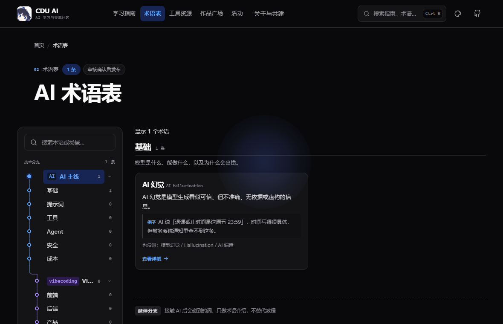

### 2026-10-28 · 顶部导航光效汇聚

- 维护者反馈：「当鼠标指着这一排按钮时，光效汇聚在按钮上，点亮指着的这个按钮」。
- 结构：`src/components/Header.astro` 在 `.desktop-nav` 里加了一枚纯装饰的 `.nav-glow`（`aria-hidden`）；几何由 `src/scripts/nav-dock.ts` 写入（`--nav-glow-x` / `-w` / `-h` / `-r` / `-cx`），与已有的 dock 放大共用同一个指针监听。
- 为什么要逐帧写：按钮同时被 dock 放大到 1.12 倍，只在 `pointermove` 时量一次会让光斑比按钮小一圈；现在 `requestAnimationFrame` 循环里只要指针还在按钮上就重新贴合，宽高也不参与 CSS 过渡——过渡只留给位移与淡入淡出，读起来才是「光挪过去」而不是「光被拉长」。
- 视觉：`src/styles/vibe.css` 里的光斑只用两层径向渐变 + `blur(4px)`，不描边、不画胶囊底。第一版试过「渐变 + 1px 内描边 + 半透明胶囊底」，截图里完全是一个填了色的小按钮，光感消失；改成「按钮自身不出底色，亮度全部交给光斑」之后才成立。
- 让位与兜底：光斑生效时给 `<html>` 打 `data-nav-light="true"`，`cursor-glow.css` 里据此把跟随指针的全站光晕淡出（否则指针处会有两团亮斑）；同时 `:root[data-nav-light='true'] .nav-link:hover` 的背景改为透明。减少动效、触屏、无 JS 时这套光效不启用，回到原来的半透明蓝底 hover，反馈不丢。
- 坑：`<html>` 上的标记最初也叫 `data-nav-glow`，与光斑自身的属性撞名，悬停后 `querySelector('[data-nav-glow]')` 返回的是 `<html>`，量到的宽度变成整页 1440px；已改名 `data-nav-light`。
- 实测（1440×760，Playwright + Edge，浅 / 深两套主题）：光斑矩形与按钮矩形误差 < 2px；离开导航后 opacity 归 0、`data-nav-light` 复位、全站光晕恢复；减少动效下光斑恒为 0。
- 新增浏览器回归测试「指针落到顶部导航上时光效收敛到那一枚按钮，并撤走全站光晕」。

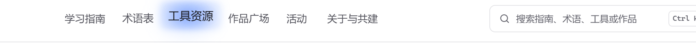

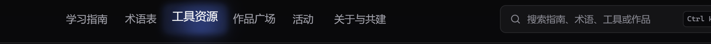

### 2026-10-28 · 光效调浅并扩展到首页引导图节点

- 维护者反馈（附首页引导图截图，指「工具资源」卡片）：「换一个浅一点的的光效颜色，再给这几个按钮也加上同样的效果」——即导航那套「光效汇聚」换成更浅的蓝，并同样施加到看板娘周围六个入口。
- 取色：光效蓝从 `#516fe3`（81, 111, 227）提亮一档到 `rgb(124, 164, 255)`（深色主题 `rgb(150, 190, 255)`），单独存为 `--glow-tint`；全站光晕与 Hero 像素仍用 `--cursor-glow-blue`。两套蓝各自成立：跟随光晕要能在白底上「染」出可见形状，汇聚光则是点到某一枚按钮上而不能压住文字。
- 共用配方：新增 `src/styles/hover-glow.css`（`.hover-glow` + `--glow-x/-y/-w/-h/-r/-cx` 几何变量 + `::before` 溢出柔光 + 深色变体），导航与引导图节点不再各写一套渐变；`vibe.css` 里原有 `.nav-glow` 整段删除，只留一条注释指向新文件。
- 卡片用 inset 变体而不是照搬导航的椭圆：卡片是扁的，58% × 104% 的椭圆在卡面上会读成「整卡填色 / 选中态」。三次迭代：① 直接套导航渐变 → 像被选中；② 52% × 120% → 仍然偏满；③ 38% × 96% + 提前衰减（34% 处就掉到 .24）+ 描边软化为 `rgba(var(--glow-tint), .5)`，才读成「一束光落在按钮上」。光斑 `inset: 0`、圆角继承卡片，宽高不参与过渡（指针进入时卡片本身有 3px 抬升）。
- 交互：`src/scripts/hover-glow.ts` 抽出 `initInsetGlow({ items, onActive })`；`hero-network.ts` 在 `pointermove`（仅鼠标且非减少动效）时写 `--glow-cx`，`pointerleave` / `blur` / 切页 / 离屏 / 减少动效切换都熄灭，并给 `<html>` 置 `data-hero-light="false"`；与导航一致，`cursor-glow.css` 依据该标记把全站光晕淡出，避免同一处两层亮斑。
- 实测（1440×900，Playwright + Edge，双主题）：悬停「工具资源」卡片 → `data-hero-light='true'`、光斑不透明度 1、`cursor-glow` 为 0；光斑 134×50 对卡片 136×52（1px 边框造成的两圈差）；两处光斑取色完全一致（同一个 `--glow-tint`）。
- 坑：写回归测试时最初把「离开卡片」的落点定在卡片下方 120px，正好落进下面那张「作品广场」，`data-hero-light` 仍为 `true`；改成往卡片左侧 160px（看板娘身上）后通过——断言「离开后熄灭」时落点必须确认没压在另一张卡上。
- 截图重出：浅色 tint 版本替换 `nav-glow-light.png` / `nav-glow-dark.png`，新增 `hero-node-glow-light.png` / `hero-node-glow-dark.png`。

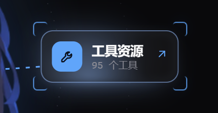

### 2026-10-28 · 页头控件与首屏主按钮接入同一束光

- 维护者反馈（附两张截图：首屏「开始学习」按钮、页头搜索框与右侧两个图标键）：「再给这几个按钮也加上同样的效果」。
- 复用而不是重画：这些控件都是实心／带底色的矩形，直接套首页引导图那套 `.hover-glow--inset`（38% 椭圆 + 溢出柔光），只补两条基础规则——`.hover-glow-host { position: relative; isolation: isolate }` 与子层 `z-index: -1`，让光压在控件底色之上、文字与图标之下，否则半透明光会糊在字上，读起来像按钮被压暗。
- 驱动器抽成 `src/scripts/ui-glow.ts`：在 document 上做事件委托，找 `[data-glow-host]`，写 `--glow-cx`，亮起时给 `<html>` 打 `data-ui-light`（`cursor-glow.css` 据此让全站光晕让位）；键盘 `focusin` 也点亮，亮心放控件中央。指针轨迹合并到一帧一次（`requestAnimationFrame`），减少动效 / `hover: none` 下直接跳过。
- 主按钮踩了两次坑：① 直接套淡蓝，实测悬停后中段 RGB 从 73,125,238 变成 81,120,228——**整体反而变暗**，因为 `.btn--primary:hover` 把底色换成了更深的 `--brand-strong`，光被底色变化吃掉；② 于是亮起时给宿主打 `data-glow-on`，CSS 锁住 `.btn--primary[data-glow-on='true']` 的底色为 `--brand`，并把品牌色实心底上的光改成掺白的掠光（白 0.62 → 0.3 → 0.08 衰减）。深色主题还要单独写一遍：`.hover-glow--inset` 的深色规则特异性更高，会盖掉按钮自己的渐变。
- 实测（1440 宽，浅色主题取样按钮中段与右侧三分之一）：中段 73,125,238 → **112,153,243**、右侧 44,104,236 → 118,157,244；深色主题中段 84,145,220 → **109,158,221**、右侧 93,161,243 → 140,186,245。
- 与导航、引导图节点一致：所有光共用 `--glow-tint`（浅色 `rgb(124,164,255)` / 深色 `rgb(150,190,255)`），只有主按钮那一层掺了白；光斑为控件内框尺寸（1px 边框差 ≤3px）。
- 测试：新增「页头控件与主按钮也用同一套光效」——主按钮 + 搜索框 + 主题键 + GitHub 键逐个悬停，断言点亮、透明度 >0.9、光宽 ≈ 控件宽、`data-ui-light` 为 true、全站光晕 <0.05，离开后熄灭并把光交还全站；减少动效下不点亮。原有两条 glow 测试的 `data-node-glow` 选择器随通用化改为 `data-glow`。
- 全量验证：`npm run verify` 44 项测试全过、构建 10 页、内链通过；`PLAYWRIGHT_CHANNEL=msedge npm run test:browser` **25/25 通过**。

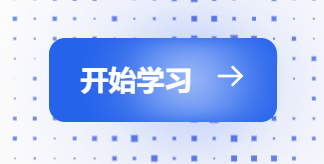

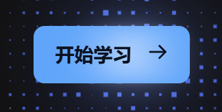

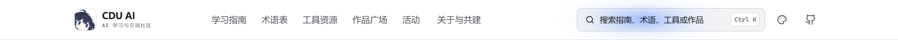

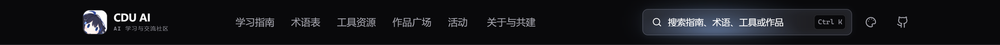

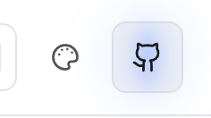

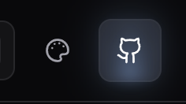

### 2026-10-28 · 站内同类按钮全部接上同一束光

- 维护者反馈：「给所有的类似按钮都加上同样的效果」。
- 范围判定：给**行动入口**一致的反馈，而不是让整页发光。接管 `.btn`（primary / soft / ghost / sm，含 404、活动、作品、关于各页的按钮组）、`.filter-chip`、`.clear-filters`、`.copy-button`、`.term-copy`、`.term-prompt__copy`、场景「换一张」、搜索对话框关闭键、主题面板的关闭键 / 行按钮 / 小按钮 / 字体选项。刻意不接：取色色块（光会盖掉正在挑选的颜色）、正文里的步骤与测验选项（属于阅读内容）、导航链接（已由 nav-glow 处理，再叠一层会双重发光）。
- 实现方式改成「自动接线」，而不是再去十几个文件里补标记：`ui-glow.ts` 启动时按选择器给命中控件补 `.hover-glow-host`、`data-glow-host` 并插入一层 `.hover-glow--inset`（已有静态光层的不重复插入），再用 MutationObserver 补挂后渲染出来的按钮（主题面板重建、筛选结果）。以后新增按钮只要写自己的语义样式，光会自动跟上；要加一类新控件就往 `AUTO_HOSTS` 里加一个选择器。
- 驱动器相应放宽：`hover-glow.ts` 原来只在初始化时给传入的 items 建映射表，现在「查不到就现查并缓存」，运行中才注入的宿主也能点亮；`ui-glow.ts` 的事件委托也从「必须在这个数组里」改成 `closest('[data-glow-host]')`。
- 层叠与安全：`.hover-glow-host` 的 `isolation: isolate` 加光层 `z-index: -1`，光压在控件底色之上、文字与图标之下，所以筛选片、复制键这类小控件亮起时字始终清楚；同时只亮一枚，切换时旧的立刻熄灭。
- 实测覆盖（工具页 62 个 `button` / 链接按钮）：40 个接上光效，剩余 22 个全是主题面板里的取色色块——即刻意排除项以外没有漏网。术语页复制键、关于页次级按钮、筛选片三处的截图见下。
- 测试：新增「站内同类按钮自动接上同一束光」——关于页整排 `.btn` 全部带宿主类且只有一个光层、悬停次级按钮点亮且光宽 ≈ 按钮宽、宿主 `isolation` 为 `isolate`；工具页整列筛选片与「清除筛选」全覆盖、亮起时通知全站、同时只有一枚 `data-active`；术语页复制键点亮。
- 全量验证：`npm run verify` 44 项测试全过、构建 10 页、内链通过；`PLAYWRIGHT_CHANNEL=msedge npm run test:browser` **26/26 通过**。

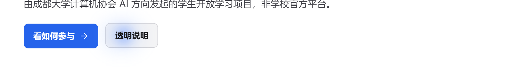

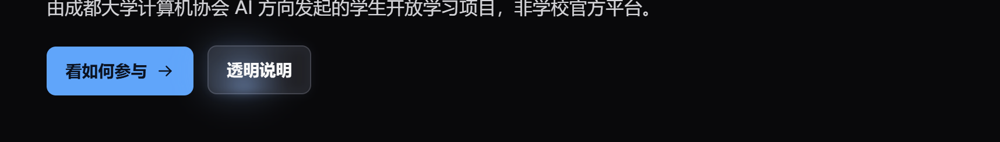

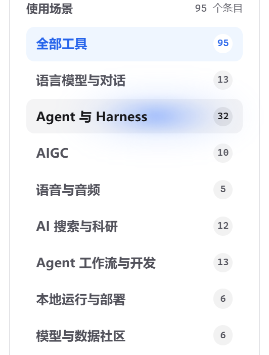

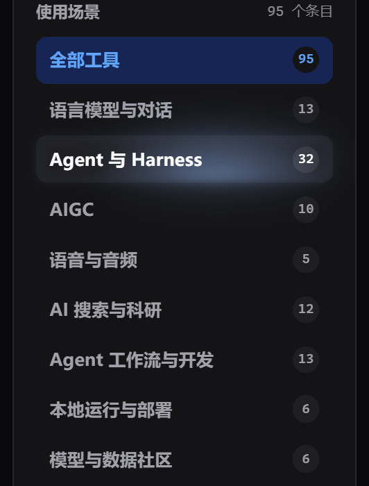

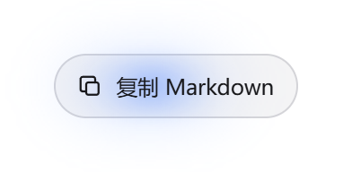

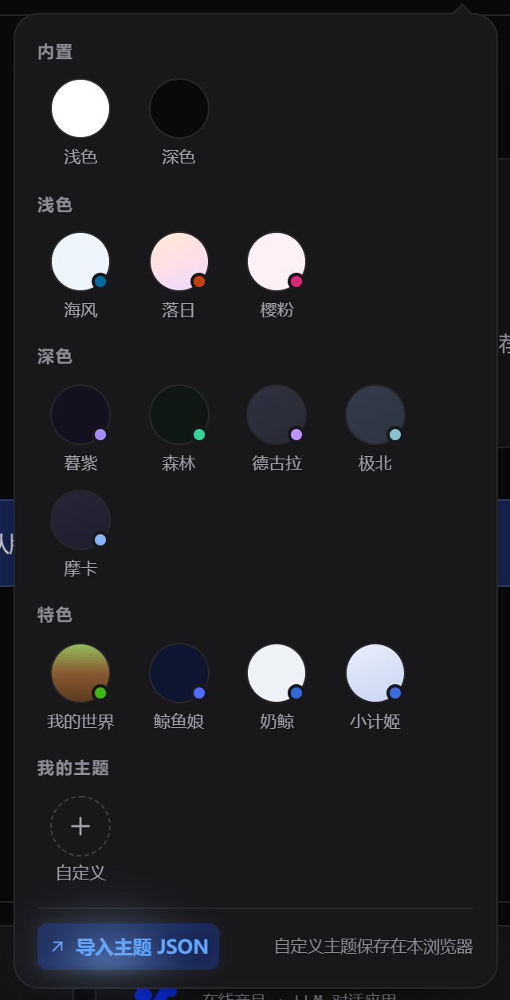

### 2026-10-28 · 侧栏搜索框与列表卡片也接上光效

- 维护者反馈：「这里和小卡片也加上」（附工具页侧栏截图：搜索框 + 下方一枚筛选片）。这里的「小卡片」按最宽的解释一起做了：工具卡、术语卡，以及术语页侧栏的分类分支行。
- 侧栏搜索框（`.search-field`，工具页与术语页各一处）最大的问题是层叠：输入框有自己的底色（`background: var(--bg)`），把 `.hover-glow` 按常规放在 `z-index: -1` 会被输入框整个挡住，指针落上去只能看到外面一圈溢出的柔光。改成这一层抬到输入框之上（`z-index: 1`）、浓度压到通用 inset 的一半左右，读起来是光从输入框里透出来；文案仍在光的下方，实测占位文字与输入文字都清楚。
- 列表卡片（`.tool-card` / `.glossary-term`）不用渐变：维护者要求「卡片用点光效，指着的卡片那一圈点亮」，所以卡面铺的是点阵——10px 一格、1px 的蓝点，外面套一层径向遮罩，只有指针附近的点会亮，亮心跟着指针的横纵坐标走（为此给 `hover-glow.ts` 加了 `--glow-cy`，`ui-glow.ts` 把 `clientY` 一路传下来）。指着的那张卡再由宿主自己点亮一圈描边：`border-color` 换成品牌蓝 + `0 0 0 1px` 内环，深色再加一层 24px 外发光；卡片原本的 `:hover` 只把描边换成 `--line-strong`，这里接力成光。
- 接入方式不变，只往 `AUTO_HOSTS` 加四个选择器：`.search-field`、`.tool-card`、`.glossary-term`、`.branch-row__label`。四者此前都没有光层标记，靠 `ui-glow.ts` 自动补宿主并插光，没有改任何页面模板。
- 同时只亮一处这条规则在卡片上带来一个副作用：卡片内部还有「打开官网」「代码仓库」链接与「展开细节」，指针从卡面移到这些内层控件时，光会从整张卡切到那枚小节上——因为全局只有一个 `active`。目检后保留这个行为：内层控件本来就该比整卡更亮，且切换是同一帧内的交接，看不出闪烁。
- 测试：新增「侧栏搜索框与列表卡片接上同一束光」——工具页搜索框只有一个光层、悬停后点亮、`z-index` 为 `1`、光宽 ≈ 输入框宽、亮心 `--glow-cx` 随指针偏到右半边、并通知全站光晕让位；工具卡整片全覆盖、悬停点亮且同时只有一张卡 `data-active`；术语页术语卡与侧栏分支行全覆盖、分别悬停可点亮、同时只有一处发光。
- 全量验证：`npm run verify` 44 项测试全过、构建 10 页、内链通过；`PLAYWRIGHT_CHANNEL=msedge npm run test:browser` **27/27 通过**。

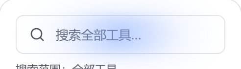

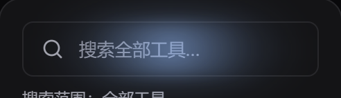

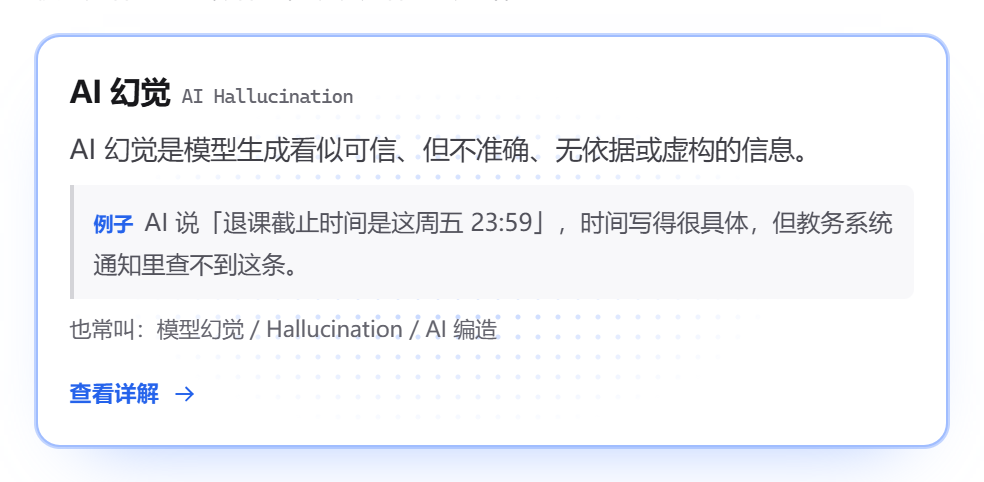

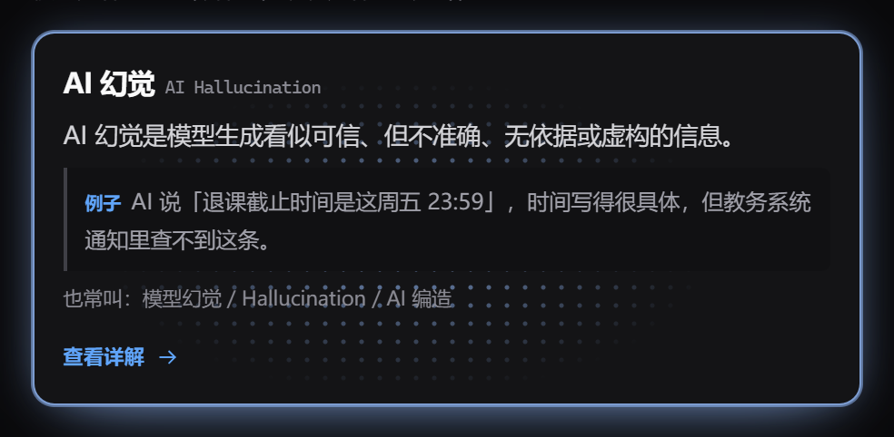
