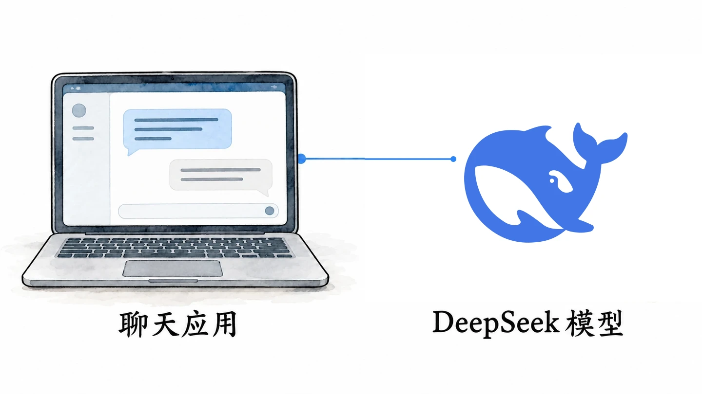

这是成都大学计算机协会 AI 方向发起的学习网站。我想把它慢慢做起来，分享一些真正用得上的知识和经验，也希望对 AI 感兴趣的同学能在这里找到自己的起点。

如果你刚开始接触 AI，不用急着弄懂一堆技术名词。我们可以先从熟悉的工具聊起，再慢慢看看它们是怎么工作的。

你可能已经用 DeepSeek、豆包聊过天，也可能只是听说过这些名字。都没关系，我们就从一个简单的问题开始：平时说的 AI，到底是什么？它又能帮我们做些什么？

## 我们日常所说的 AI，是什么？

AI 是 *Artificial Intelligence* 的缩写，中文是人工智能。

人工智能很难用一句话说清楚。研究者会从学习、推理、感知、决策等不同角度理解它，而且这个领域本身也一直在变化。入门时不必急着记定义，可以先把它看作一个研究领域：人们用各种方法，让计算机完成一些通常需要人类智能参与的任务，比如识别图像、理解语言、从数据中发现规律，或生成新的内容。

你可能还听过机器学习、深度学习和神经网络。简单说，机器学习是实现人工智能的重要方法之一；深度学习则是机器学习的一个分支，主要通过多层神经网络从数据中学习规律。

有一点值得先记住：**人工智能并不是最近几年才出现的。**

手机识别文字、语音输入和视频平台的内容推荐，都可能用到人工智能技术。它们没有聊天框，也不会像聊天助手那样回答问题，但同样属于 AI 的应用。

近几年，大语言模型和生成式 AI 发展得很快，我们才更常见到可以直接用日常语言交流的 AI 工具。接下来，我们会多聊聊这类应用。

## 从大语言模型说起

如果你用过 ChatGPT 或 DeepSeek，就已经接触过大语言模型。它的英文是 *Large Language Model*，通常简称 LLM，是这类聊天助手背后的重要技术之一。

<figure class="guide-home-illustration guide-home-illustration--model">

</figure>

说到大语言模型，经常也会听到 Transformer。2017 年发表的论文《Attention Is All You Need》提出了 Transformer 架构，后来它成为许多主流大语言模型的重要技术基础。现在不必研究它的具体结构，先认得这个名字就够了。

大语言模型会用大量数据训练，从中学习语言规律；回答问题时，它会结合我们提供的内容和对话上下文生成文字。这让我们和软件打交道的方式有了变化：过去常常要先找到功能、熟悉操作，再一步步完成任务；现在，很多时候只要把需求说清楚，就能开始尝试。

比如，你可以让它解释一个没弄懂的知识点，也可以请它帮你整理思路。觉得回答不合适，就继续追问、补充条件，直到找到自己能理解的说法。

不过，它给出的内容不一定正确，有时还会把编造的信息说得很像真的。这种现象通常叫作「AI 幻觉」。

先记住一个区别就好：**模型不等于应用**。例如，ChatGPT 是应用产品，GPT 是模型系列；而「DeepSeek」既可以指聊天应用，也可能指 DeepSeek 的模型系列，具体要看上下文。大语言模型也只是人工智能的一部分。

同一个模型放在不同应用里，体验也可能不一样：应用提供的工具、权限、上下文管理都会影响结果。你还会遇到[上下文窗口](/glossary/context-window/)（模型一次能处理的信息范围）、[Token](/glossary/token/)（模型处理文本时常用的计量单位）等词；不必背定义，遇到「为什么忘了前文」「为什么消耗额度」时再来查。

**免费额度、订阅和 API 按量计费不是一回事。** 选工具时，先确认自己用的是哪个产品、有没有额度或付费限制，再根据实际任务决定是否需要更强的模型，不必为了追最新而付费。

## AI 还能做些什么？

AI 不只存在于聊天框里。现在有不少工具能按文字描述生成图片，也能根据图片生成视频，或把文字转换成语音。你可能已经在网上见过这些作品。

这类应用通常属于生成式人工智能（*Generative AI*），也常和 AIGC（人工智能生成内容）这个说法一起出现。大语言模型生成文字也是生成式 AI 的一种；而图像、视频和音频生成，往往会用到其他类型的模型和技术。不同工具各有所长，很难简单排出高低。

<figure class="guide-home-illustration">

</figure>

还有一个值得了解的方向是 AI Agent，也就是智能体。

先用一个例子来理解：如果要整理很多课程资料，你可以把文件逐个发给聊天助手，让它帮你分析和分类，再由自己动手整理。具备文件操作能力的 Agent，则可能在得到授权后读取指定文件夹，按要求整理资料，并生成一份结果清单供你检查。

这里的重点不是 Agent 一定比聊天助手「更高级」。有些聊天助手本身也能调用工具、执行任务，两者并不是截然分开的。更重要的变化是，AI 不只能提供信息，也可以借助工具参与实际工作。

当 AI 能读取或修改文件、运行程序时，我们也得弄清楚它能访问什么、具体做了什么。

## 我想在这里分享什么？

我喜欢从实际使用中发现问题，再带着问题去学。做这个网站，我也想从大家会遇到的需求出发，聊聊工具怎么用、哪里容易卡住，以及哪些知识能帮我们理解手上的问题。

这里的内容会逐步补充。你可以从目录里挑一个自己感兴趣的主题。

## 我有一些想说的话：

AI的发展很快，新模型和新工具总会不断出现。我们不应只停留在关注模型发布、比较性能和讨论谁更强上，却忽略了 AI 原本可以帮助我们做些什么。AI只是工具，学习使用它，去完成你的想法、减少工作量、提高学习效率，才是作为一个大学生应该值得尝试的地方。

未来会如何，我也不知道，但我认为，跟随时代，走一步看一步就行了。
