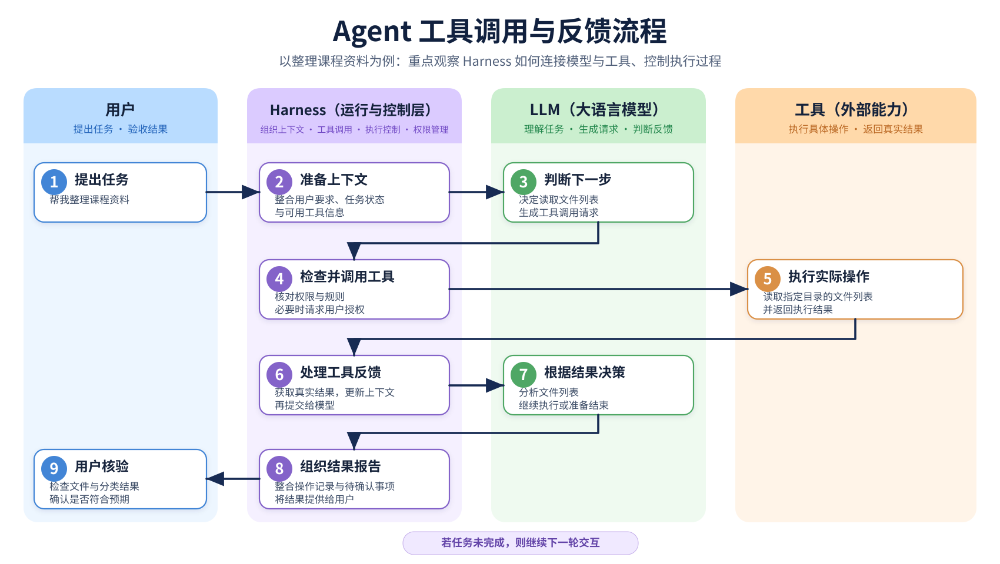

在上一章，我们聊过 AI 使用时的一些常见问题。接下来，带你认识两个可能已经听说过的词：**Agent** 和 **Harness**。

先不用急着弄懂复杂的技术。可以从我们熟悉的聊天框，以及一件很普通的事开始。

## 以前，我们主要让 AI 回答问题

假设学期快结束了，你的电脑里放着不少课程资料：PDF 课件、Word 文档、实验讲义，还有一些文件名乱七八糟的笔记。

你打开一个聊天助手，说：“帮我整理一下这些资料，按课程分类，再列出每门课的复习重点。”

它可以告诉你怎么分类，也可能在你上传文件后，帮你阅读内容、生成复习提纲。这样其实已经满足了很多需求了。

但它没有操作本地文件的能力，**真正创建文件夹、移动文件、修改名称的工作，还是需要你自己完成**。

那么，有没有办法让 AI 不只告诉我怎么做，还能在我允许的范围内，实际帮我做一部分？

## 如果让 AI 自己动手呢？

这就是理解 Agent 的一个切入点。

还是刚才的例子。假设你使用的 AI 工具具备读取和整理文件的能力，并且你授权它访问指定的测试文件夹。

它就有可能先查看里面有哪些文件，根据内容提出分类方式，再创建文件夹、复制整理资料，最后给你一份结果。遇到分不清的文件，它也可以停下来问你。

这时，**AI 开始借助工具，对任务采取实际行动**。

当然，不是所有叫作 Agent 的产品都能操作你的电脑。它具体能做什么，取决于所连接的工具、运行环境和你给予的权限。

## Agent 到底是什么？

Agent 通常译为“智能体”。不同产品和研究者对它的划分并不完全一样，但入门时可以先这样理解：

**Agent 是一种围绕任务目标，利用 AI 模型判断下一步做什么、调用可用工具，并根据执行结果继续行动的系统。**

它一般会经历这样的过程：

1. **理解任务**：你希望完成什么，有哪些要求和限制？
2. **决定下一步**：先读取资料，还是先创建目录？
3. **使用工具**：在获得相应能力和授权后，搜索信息、读取文件或执行操作。
4. **查看结果**：工具有没有成功？文件是否分类正确？要不要调整？
5. **结束或继续**：完成任务后报告结果，或者遇到问题时向你求助。

以前使用聊天 AI，模型给我们生成的是文字回答。为什么到了 Agent，它就能操作文件、运行程序了？

实际上，**大语言模型（LLM）本身并不会因为生成了一句话，就自动完成对应的操作。**

比如，模型可以根据你的任务，提出“先读取文件夹中的文件列表”，甚至生成一个具体的工具调用请求。但这个请求并不意味着文件已经被读取。

要真正完成操作，还需要有软件接收请求、调用对应工具，并把执行结果返回给模型。

接下来，就要认识 Agent 系统中一个很重要的部分：Harness。

## 认识 Harness

**Harness** 这个词在 AI 领域目前还没有完全统一的中文译名。你可以暂时把它理解为围绕 AI 模型建立的**运行与控制系统**。

它是帮助模型与外部工具一起协作，让任务能够持续运行的一套机制。

还是用刚才整理课程资料的例子。

假设你已经授权 Agent 访问某个测试文件夹。当模型希望查看里面有哪些文件时，它可以发出工具调用请求，由 Harness 处理，再将实际读取的结果返回给模型。

这个交互过程可以通过下面的流程图来理解：



如果任务还没有完成，模型就可以根据新获得的信息判断下一步要做什么，这个过程也就可能继续循环。

**模型提出要做什么，Harness 组织和控制执行过程，工具负责完成具体操作，再把结果反馈回来。**

这就是一种常见的 Agent 工作方式。当然，实际产品的实现可能更复杂，部分操作也可能由预先编写的程序决定，而不是每一步都由模型判断。

这样一来，你也就能理解 Harness 为什么重要了。

它通常承担着几类工作：

- **上下文管理**：组织对话、任务要求和工具结果，让模型知道当前进行到了哪一步。
- **工具调用**：处理模型发出的工具请求，连接文件、浏览器或其他外部服务。
- **执行控制**：组织模型与工具之间的交互，处理部分错误，决定何时继续、暂停或结束。
- **权限管理**：依据软件的权限策略限制操作，并在需要时让用户确认。

这里再区分一下三个概念：

- **LLM 是模型**，负责根据输入生成回答、判断或工具调用请求。
- **Harness 是运行机制**，负责组织模型与工具之间的交互及执行过程。
- **Agent 是整个任务系统**，利用模型、Harness 和可用工具等组成部分，围绕目标开展工作。

简单理解就是Agent=LLM+Harness

也正因如此，你可能会发现：

**同一个大语言模型，在不同的 Agent 产品中，完成同样任务的表现可能不一样。**

因为结果不仅受到模型本身能力的影响，还与 Harness 如何组织上下文、提供哪些工具、怎样控制执行过程等因素有关。

一个好的 Harness 可以帮助模型更有效地完成任务，但不能凭空消除模型自身的能力限制。

## 那 Chat AI 和 Agent 是两种不同的软件吗？

不一定。它们之间没有一条绝对清晰的分界线。

以前，我们可能习惯把 Chat AI 理解成“我问一句，它答一句”，把 Agent 理解成“我给出目标，它尝试完成”。这种说法有助于入门，但不是一个严格的划分方法。

其实，现在不少 AI App/Web 已经具备一定的 Agent 能力。例如联网搜索、分析上传的文件、运行代码，或者调用其他应用完成多步骤任务。同一个产品里，聊天与 Agent 式的使用方式也可能同时存在。

不过，这里需要注意一个区别：**AI 能够处理你上传的文件，不代表它就能直接访问、修改你电脑上的其他文件。**

很多网页 AI 的操作范围主要在平台提供的环境内，或者你主动连接的应用中。它可以帮你生成一个 Excel 文件，但未必能够直接打开你电脑中的某个文件夹，把里面的文件整理好。

而近来，还有一种受到关注的发展方向，叫作 **Personal Agent（个人智能体）**。

这类产品更强调与个人使用的应用、工作流程和长期需求结合。它不只是回答你当前提出的问题，还希望能够记住任务背景、持续推进工作，必要时主动向你反馈。

这里可以看看两个比较新的产品：

**第一个是 [Grok Bot](https://x.ai/news/introducing-grok-bot)。**

它把 Agent 设计成可以长期工作的 AI 数字队友。根据官方介绍，Grok Bot 拥有自己的云端计算机，可以登录和使用不同的应用、网站及工作工具，替用户完成跨应用的任务。

你可以像给同事发消息一样，向它交代工作。即使暂时离开，它也可以继续执行任务，并在需要你作出决定时请求确认。

**另一个是 Meta 推出的 [Muse](https://ai.meta.com/muse/)。**

相比之下，Muse 更明确地将自己定位为个人智能体。它可以通过应用或 WhatsApp 与用户交流，并连接日常使用的服务，帮助处理邮件、日程、预约、资料整理等任务。

Muse 也拥有独立的云端虚拟计算机和浏览器，可以在获得相应授权后执行多步骤操作。对于一些需要持续处理的任务，即使用户关闭应用，它仍然可以继续工作，并在需要确认时联系用户。

不过，无论是 Grok Bot 还是 Muse，都不能简单理解成“AI 已经可以随意操作我的整台电脑”。

它们使用的云端计算机与你正在使用的本地电脑并不是同一回事。能够访问哪些应用、文件和账号，仍取决于产品提供的连接方式、运行环境和权限设置。

而且，当 AI 能持续处理个人事务，甚至代表你发送信息、操作账号时，隐私保护与权限控制也会变得更加重要。

## 是不是以后什么都交给 Agent 就好了？

我不太建议这样理解。

如果只是想知道一个概念是什么意思，直接聊天往往更简单。为了回答一道普通问题，让 Agent 读取文件、规划步骤、调用一堆工具，反而可能更慢，也增加出错的环节。

但如果任务需要反复查找资料、处理多个文件，或者执行一系列相互关联的操作，Agent 就可能帮上更多忙。

**需要使用 Agent，不是因为它听起来更高级，而是因为任务确实需要它的执行能力。**

而且，Agent 会执行，不代表它一定执行得对。你在上一章已经见过类似的提醒：重要文件要备份，权限要控制，最终结果仍要亲自检查。

## 可以先试一个简单的任务

如果你已经在使用具备文件操作能力的 Agent，可以先准备一个只放测试资料的文件夹，再给它一个小任务，例如：

```text
我想整理这个文件夹里的课程资料。

请先读取文件列表，提出分类方案，不要立即修改文件。

等我确认后，再把文件复制到对应的分类文件夹。

不要删除或覆盖原文件，也不要访问指定文件夹以外的位置。

完成后告诉我：你做了哪些操作、哪些文件没有处理、有什么需要我检查。
```

如果你目前使用的工具只能聊天，没有文件操作能力，也没关系。可以先让它提出整理方案，再由自己动手完成。两种方式都能帮助你理解任务的过程。

我希望这一章能让你先记住一件事：

**从 Chat AI 到 Agent，重要的变化不是 AI 突然变得无所不能，而是模型能够在 Harness 等运行机制的支持下使用工具，参与完成真实任务。**

下一篇，我们继续聊聊 [Agent 能做什么](/guide/agent-capabilities/)：除了整理文件，它还能帮助我们完成哪些学习、创作和日常任务？
